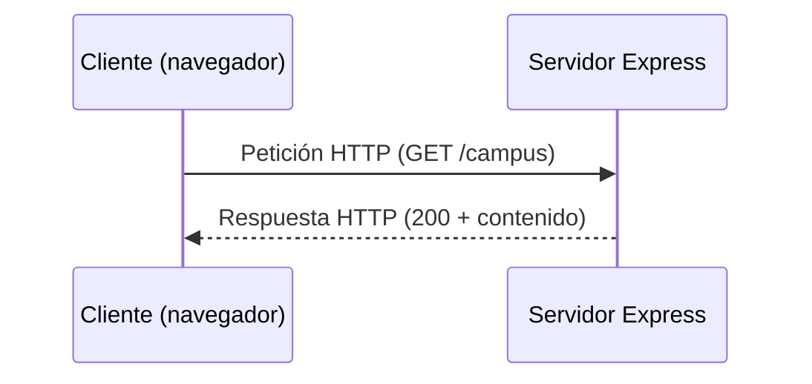

# Introducción a Node.js con Express.js

## Introducción

[Node.js](../conceptos/nodejs/nodejs.md) es un entorno de ejecución de código abierto y multiplataforma que permite ejecutar JavaScript fuera del navegador. Está orientado a operaciones asíncronas y basadas en eventos: una tarea que espera una respuesta, como una consulta a una [base de datos](../conceptos/bases-de-datos/base-de-datos.md), no detiene el resto del programa. Esto permite construir aplicaciones en red [escalables](../conceptos/ingenieria/escalabilidad.md).

Sobre Node.js se construye [Express.js](../conceptos/web/express.md), un marco de trabajo que simplifica el desarrollo de aplicaciones web y APIs. Esta lección presenta las herramientas básicas del área: [npm](../conceptos/nodejs/npm.md), [nvm](../conceptos/nodejs/nvm.md), Express.js, el [modelo cliente-servidor](../conceptos/web/modelo-cliente-servidor.md), los [middlewares](../conceptos/web/middleware.md), [nodemon](../conceptos/nodejs/nodemon.md) y [dotenv](../conceptos/nodejs/dotenv.md).

---

## 1. Node.js

Node.js es:

* Un entorno de ejecución de código abierto.
* Multiplataforma: funciona en Windows, Linux y macOS.
* Un entorno que ejecuta JavaScript fuera del navegador.
* Un entorno orientado a eventos y a operaciones asíncronas.
* Una base para construir aplicaciones en red escalables.

> [!NOTE]
> Para ver la arquitectura interna de Node.js, consulta [Entornos de ejecución con Node.js](../nodejs/01-entornos-de-ejecucion.md).

---

## 2. npm (Node Package Manager)

[npm](../conceptos/nodejs/npm.md) es el gestor de paquetes de Node.js y una parte esencial del ecosistema. Se alimenta del registro en línea donde se publican los paquetes reutilizables y permite instalar, actualizar, configurar y eliminar programas y librerías de JavaScript.

```bash
npm init -y                      # crea el archivo package.json
npm install express              # instala una dependencia
npm install --save-dev nodemon   # instala una dependencia de desarrollo
npm uninstall express            # elimina una dependencia
npm update                       # actualiza las dependencias según su rango de versión
```

---

## 3. nvm (Node Version Manager)

[nvm](../conceptos/nodejs/nvm.md) administra las versiones de Node.js instaladas en el equipo. Permite tener varias versiones, cambiar entre ellas e instalar o desinstalar una versión específica. Es útil cuando se quiere actualizar Node.js o cuando un proyecto necesita una versión concreta.

```bash
nvm ls-remote        # lista las versiones disponibles
nvm install --lts    # instala la versión LTS
nvm use --lts        # usa la versión LTS
nvm ls               # muestra las versiones instaladas
```

> [!NOTE]
> nvm funciona en Linux y macOS. En Windows se usa nvm-windows, que es un proyecto distinto con comandos parecidos pero no idénticos.

---

## 4. Express.js

[Express.js](../conceptos/web/express.md) es un marco de trabajo minimalista y flexible para Node.js. Proporciona solo las herramientas esenciales: definición de rutas, middlewares, manejo de peticiones y respuestas HTTP, y configuración del servidor. El resto se agrega según las necesidades del proyecto.

Se instala como cualquier dependencia:

```bash
npm install express
```

---

## 5. Modelo cliente-servidor

En el [modelo cliente-servidor](../conceptos/web/modelo-cliente-servidor.md):

* El **servidor**, construido con Express, actúa como proveedor de recursos y servicios.
* El **cliente**, como un navegador web, consume esos recursos y servicios mediante peticiones HTTP.



Con Express se pueden definir rutas para manejar distintos métodos HTTP, usar middlewares para procesar peticiones y errores, y configurar el comportamiento del servidor según las necesidades de la aplicación.

---

## 6. Middleware

Un [middleware](../conceptos/web/middleware.md) es una función que recibe el objeto de solicitud (`req`), el objeto de respuesta (`res`) y la función `next`. Los middlewares forman una pila que se ejecuta en secuencia cuando llega una petición HTTP.

Un middleware puede procesar datos de la petición, modificar la respuesta, autenticar usuarios, gestionar errores u otras tareas. Cuando termina su trabajo, pasa el control al siguiente middleware con `next()`.

```mermaid
flowchart LR
    A[Petición] --> B[Middleware 1]
    B -->|next()| C[Middleware 2]
    C -->|next()| D[Ruta]
    D --> E[Respuesta]
```

> [!WARNING]
> Si un middleware no llama a `next()` ni envía una respuesta con `res`, la petición queda sin terminar.

### 6.1 Parámetros de un middleware de ruta

```javascript
import express from 'express';

const app = express();

app.get('/', (req, res, next) => {
    next();
});

app.listen(3000);
```

| Elemento | Significado |
| --- | --- |
| `app.get` | Método HTTP al que se aplica el middleware |
| `'/'` | Ruta a la que se aplica |
| `(req, res, next)` | Función del middleware |
| `req` | Objeto de la petición HTTP (nombre por convención) |
| `res` | Objeto de la respuesta HTTP (nombre por convención) |
| `next` | Función que pasa el control al siguiente middleware (nombre por convención) |

Como este middleware no envía respuesta, el cliente recibirá un error `404` de Express. Es un buen ejemplo para entender que cada middleware decide si termina la petición o pasa el control.

> [!NOTE]
> Con CommonJS, el mismo código usa `const express = require('express');`. En este área se usa `import` porque el proyecto declara `"type": "module"` en su `package.json`.

---

## 7. Primera aplicación con Express

Pasos para crear la aplicación:

1. Crea una carpeta, entra en ella y ejecuta `npm init -y`.
2. Agrega `"type": "module"` en el `package.json`.
3. Instala Express con `npm install express`.
4. Crea el archivo `app.js`.
5. Ejecuta la aplicación con `node app.js`.

```javascript
import express from 'express';

const app = express();

app.get('/', (req, res) => {
    res.send('Hello World');
});

const config = {
    host: '127.0.0.1',
    port: 5510
};

app.listen(config, () => {
    console.log(`http://${config.host}:${config.port}`);
});
```

En la consola aparecerá `http://127.0.0.1:5510`. Al abrir esa dirección en el navegador, se mostrará `Hello World`.

> [!WARNING]
> La opción que lee Node.js para la dirección es `host`, no `hostname`. Si escribes `hostname`, Node.js la ignora y el servidor escucha en todas las interfaces, aunque el mensaje de la consola muestre `127.0.0.1`.

Express 5 pasa los argumentos de `app.listen` a `server.listen` de Node.js. Por eso acepta un objeto con `host` y `port`, además de la forma clásica `app.listen(puerto, callback)`.

---

## 8. nodemon

### 8.1 ¿Qué hace nodemon?

[nodemon](../conceptos/nodejs/nodemon.md) (*node monitor*) es una herramienta de desarrollo que observa los archivos del proyecto y reinicia el servidor automáticamente cuando detecta cambios.

* **Monitoreo automático:** observa archivos como JavaScript, [JSON](../conceptos/formatos/json.md), HTML y CSS.
* **Reinicio automático:** al guardar un cambio, reinicia el servidor sin que haya que detenerlo y ejecutarlo de nuevo.
* **Configuración:** permite ignorar archivos o carpetas, como `node_modules`.
* **Integración:** se ejecuta desde los scripts de npm y funciona con frameworks como Express.

### 8.2 Instalación y uso

```bash
npm install --save-dev nodemon
```

Agrega un script en el `package.json`:

```json
"scripts": {
    "dev": "nodemon app.js"
}
```

Después ejecuta:

```bash
npm run dev
```

### 8.3 Configuración opcional

Para personalizar el comportamiento, crea un archivo `nodemon.json` en la raíz del proyecto:

```json
{
    "ignore": ["node_modules"],
    "ext": "js,json"
}
```

> [!NOTE]
> nodemon es una herramienta de desarrollo. En producción se ejecuta el servidor directamente con `node app.js`.

---

## 9. dotenv

[dotenv](../conceptos/nodejs/dotenv.md) es una biblioteca que carga las variables definidas en un archivo `.env` dentro de `process.env` cuando arranca la aplicación.

El archivo `.env` es de texto plano y contiene pares clave-valor, sin espacios alrededor del signo `=`:

```text
DATABASE_URL=mi_bd_url
API_KEY=mi_clave_de_api
PORT=3000
```

Para usar las variables:

```javascript
import 'dotenv/config';

console.log(process.env.DATABASE_URL);
console.log(process.env.API_KEY);
```

> [!IMPORTANT]
> Los valores de `process.env` siempre son texto. Si necesitas un número, conviértelo, por ejemplo con `Number(process.env.PORT)`.

> [!IMPORTANT]
> Si un módulo lee `process.env` al cargarse, debe importar `dotenv/config` por sí mismo. En módulos ES, los `import` se ejecutan antes que el resto del código del archivo.

> [!WARNING]
> El archivo `.env` suele contener credenciales. Nunca lo subas al repositorio: agrégalo a `.gitignore`.

---

## 10. Errores comunes

| Síntoma | Causa | Solución |
| --- | --- | --- |
| `Cannot use import statement outside a module` | Falta `"type": "module"` en `package.json` | Agrega la propiedad |
| El servidor escucha en otra dirección de la esperada | Se usó `hostname` en lugar de `host` | Usa `host` en la configuración |
| `Cannot GET /ruta` | La ruta no existe o el método HTTP no coincide | Revisa el método (`get`, `post`, etc.) y la ruta |
| La petición nunca responde | Un middleware no llama a `next()` ni envía respuesta | Llama a `next()` o usa `res` para terminar la petición |
| `process.env.X` es `undefined` | El `.env` no existe, el nombre no coincide o dotenv no se cargó | Revisa el nombre de la variable e importa `dotenv/config` |
| `EADDRINUSE` | El puerto ya está ocupado por otro proceso | Cambia el puerto o detén el proceso que lo usa |
| nodemon no reinicia el servidor | Se ejecuta con `node` en lugar de `nodemon` | Ejecuta `npm run dev` |

---

## Notas de apoyo

> [!TIP]
> Verifica la instalación con `node -v` y `npm -v` antes de empezar.

> [!NOTE]
> Express 5 envía automáticamente al manejador de errores las promesas rechazadas dentro de rutas `async`. En Express 4 eso no ocurría, y había que llamar a `next(error)` de forma manual.

> [!TIP]
> Usa `res.send()` para texto y HTML, y `res.json()` cuando la respuesta sea un objeto o un arreglo en formato JSON.

> [!TIP]
> Usa `npm run dev` durante el desarrollo y `npm start` para ejecutar la aplicación de forma normal. Para que `npm start` funcione, el script debe estar definido en `package.json`, por ejemplo `"start": "node app.js"`.

> [!NOTE]
> Express no es una base de datos. Los datos se conservan en almacenes externos, como MySQL, que se estudian en las lecciones de [persistencia](../conceptos/fundamentos/persistencia.md).

---

## Conexiones

* [Entornos de ejecución con Node.js](../nodejs/01-entornos-de-ejecucion.md): arquitectura de Node.js, `package.json` y registros de npm en profundidad.
* [Principios de diseño — SOLID](../nodejs/05-principios-solid.md): base para separar rutas, controladores y servicios en un proyecto Express.
* [Introducción a la persistencia de datos](../nodejs/07-introduccion-a-persistencia.md): por qué una aplicación necesita guardar [información](../conceptos/fundamentos/dato.md).
* [Persistencia de datos con MySQL y Node.js](../nodejs/08-persistencia-con-mysql.md): el siguiente paso, conectar una aplicación Node.js con una base de datos.
* [MySQL](../conceptos/motores/mysql.md): [sistema gestor de bases de datos](../conceptos/bases-de-datos/sgbd.md) que se usará en los ejemplos de persistencia.

---

## Resumen

* Node.js ejecuta JavaScript fuera del navegador con un modelo asíncrono y orientado a eventos.
* npm instala y gestiona las dependencias del proyecto; nvm administra las versiones de Node.js.
* Express.js es un marco de trabajo minimalista que simplifica la creación de aplicaciones web.
* En el modelo cliente-servidor, el servidor provee recursos y el cliente los consume mediante HTTP.
* Un middleware recibe `req`, `res` y `next`, y debe terminar la petición o pasar el control con `next()`.
* nodemon reinicia el servidor automáticamente durante el desarrollo.
* dotenv carga las variables del archivo `.env` en `process.env`, y ese archivo nunca debe subirse al repositorio.

<!-- auto:pie -->
---

**Navegación:** [Índice de Express](indice.md) · [Siguiente: API, estados HTTP, parámetros, middlewares y routers en Express.js →](02-api-http-middlewares-routers.md)
<!-- /auto:pie -->
