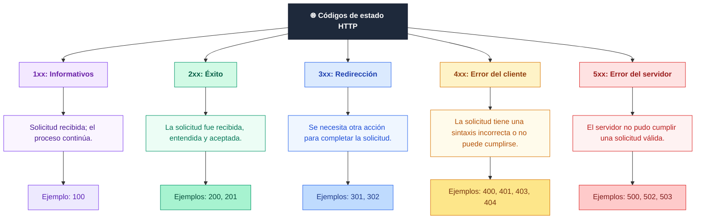

# API, estados HTTP, parámetros, middlewares y routers en Express.js

## Introducción

En la lección anterior se creó una aplicación básica con [Express](../conceptos/web/express.md). Esta lección explica cómo un servidor distingue entre peticiones distintas: qué es una [API](../conceptos/web/api.md), cómo se comunican el cliente y el servidor mediante [HTTP](../conceptos/web/http.md), cómo leer la [información](../conceptos/fundamentos/dato.md) de cada petición con [parámetros de ruta](../conceptos/web/parametro-de-ruta.md), [encabezados](../conceptos/web/encabezado-http.md) y el cuerpo, y cómo organizar las rutas con [routers](../conceptos/web/router.md).

---

## 1. ¿Qué es una API?

Una **[API](../conceptos/web/api.md)** (*Application Programming Interface*, interfaz de programación de aplicaciones) es un conjunto de definiciones y protocolos que permiten la comunicación entre componentes de software. Su propósito es facilitar la integración entre sistemas, al especificar rutinas, estructuras de datos, clases de objetos y variables que otros programas pueden utilizar.

Algunas APIs son estándares internacionales, otras son documentadas por un proveedor específico y otras forman parte de las bibliotecas estándar de un lenguaje de programación.

### 1.1 Clasificación de las APIs

* **Dependientes del lenguaje:** solo se pueden usar con la sintaxis y los elementos de un lenguaje específico. Esto optimiza su uso en ese entorno.
* **Independientes del lenguaje:** pueden utilizarse desde múltiples lenguajes. Son especialmente útiles en sistemas orientados a servicios, donde la comunicación se realiza mediante llamadas a procedimientos remotos (RPC) o servicios web (*Web Services*). Así, la integración no depende de un único entorno o tecnología.

---

## 2. Protocolos de API

| Protocolo | Primera versión | Formato | Fortaleza clave |
| --- | --- | --- | --- |
| **SOAP** | Finales de los 90 | [XML](../conceptos/formatos/xml.md) | Amplia adopción y establecido |
| **REST** | 2000 | JSON, XML y otros | Formato de datos flexible |
| **JSON-RPC** | Mediados de los 2000 | JSON | Simplicidad de implementación |
| **gRPC** | 2015 | Protocol Buffers por defecto; también JSON y otros | Capacidad de definir cualquier tipo de función |
| **GraphQL** | 2015 | JSON | Estructuración flexible de datos |
| **Thrift** | 2007 | JSON o binario | Adaptable a muchos casos de uso |

> [!NOTE]
> REST es más un estilo de arquitectura que un protocolo estricto. Por eso se implementa con HTTP y, normalmente, con JSON. Express se usa principalmente para crear APIs REST.

---

## 3. Estados HTTP

Los [códigos de estado HTTP](../conceptos/web/codigo-de-estado-http.md) son números de tres dígitos que un servidor web envía al cliente para indicar el resultado de una solicitud.

Cada vez que se hace clic en un enlace o se ingresa una URL, el navegador envía una solicitud al servidor. El servidor la procesa y devuelve el recurso pertinente junto con un encabezado HTTP, que incluye el código de estado. Aunque el código se envía en cada respuesta, en la mayoría de los casos no es visible para el usuario.



### 3.1 Códigos que se usan en esta lección

| Código | Nombre | Cuándo se usa |
| --- | --- | --- |
| `200` | OK | La petición se procesó correctamente y hay datos que devolver |
| `201` | Created | Se creó un recurso nuevo |
| `400` | Bad Request | Faltan datos o tienen un formato incorrecto |
| `401` | Unauthorized | Falta la identificación del usuario |
| `403` | Forbidden | El usuario está identificado, pero no tiene permiso |
| `404` | Not Found | El recurso solicitado no existe |
| `500` | Internal Server Error | Ocurrió un error inesperado en el servidor |

---

## 4. Creación de una petición HTTP

Un [endpoint](../conceptos/web/endpoint.md) es la combinación de un método HTTP y una ruta que el servidor atiende, por ejemplo `GET /campus`. Se define en Express con un método como `get`, `post`, `put` o `delete`:

```javascript
import express from 'express';

const app = express();

// Endpoint: método GET en la ruta /campus
app.get('/campus', (req, res) => {
    res.send('Hello developer');
});

app.listen(3000, () => {
    console.log('Servidor en http://localhost:3000');
});
```

* `app` almacena la instancia de la aplicación.
* `get` indica el método HTTP.
* `'/campus'` es la ruta del endpoint.
* La función `(req, res)` se ejecuta cuando llega una petición que coincide con el método y la ruta.

---

## 5. Parámetros y encabezados

### 5.1 Parámetros de ruta (`req.params`)

Un [parámetro de ruta](../conceptos/web/parametro-de-ruta.md) es una parte variable de la URL. Se define en la ruta con dos puntos (`:`) seguidos del nombre de la variable. Express extrae el valor real de cada petición y lo entrega en `req.params`, un objeto con pares clave-valor.

```javascript
app.get('/campus/:idCamper', (req, res) => {
    res.json({ idCamper: req.params.idCamper });
});
```

Si el cliente solicita `GET /campus/42`, la respuesta será:

```json
{ "idCamper": "42" }
```

El valor siempre llega como texto. Si necesitas un número, conviértelo con `Number(req.params.idCamper)`.

### 5.2 Encabezados (`req.headers`)

Los [encabezados HTTP](../conceptos/web/encabezado-http.md) son metadatos que se envían junto con una petición o una respuesta: el tipo de contenido, la codificación, las cookies, la autenticación y otros detalles. Express almacena los encabezados enviados por el cliente en `req.headers`, donde se pueden consultar para tomar decisiones.

```javascript
app.get('/perfil', (req, res) => {
    const rol = req.headers.role;

    res.json({ rol: rol ?? 'sin rol' });
});
```

[Node.js](../conceptos/nodejs/nodejs.md) guarda los nombres de los encabezados en minúsculas, así que `req.headers.role` funciona aunque el cliente lo envíe como `Role`.

---

## 6. Middlewares

Un [middleware](../conceptos/web/middleware.md) es una función, o un conjunto de funciones, que procesa la petición o la respuesta antes de que lleguen a su destino final. Actúa como intermediario entre el cliente y el servidor, y se ejecuta en el orden en que se define.

Un middleware puede modificar los objetos de solicitud y respuesta, validar datos, autenticar usuarios, administrar sesiones, registrar información, comprimir o cifrar datos, entre otras tareas.

### 6.1 Middlewares integrados: `express.json()` y `express.text()`

Por defecto, Express no interpreta el cuerpo de la petición. Los middlewares integrados lo leen según su tipo:

* `express.json()` convierte un cuerpo con formato JSON en un objeto disponible en `req.body`.
* `express.text()` convierte un cuerpo de texto plano en una cadena disponible en `req.body`.

```javascript
import express from 'express';

const app = express();

// Habilita la lectura de cuerpos JSON y de texto
app.use(express.json());
app.use(express.text());

app.post('/campus/:nombre', (req, res) => {
    const datos = {
        DATA: req.body,           // Cuerpo enviado por el cliente
        'URL-GET': req.query,     // Parámetros de la URL (?clave=valor)
        PARAMETROS: req.params    // Parámetros de la ruta (:nombre)
    };

    res.send(datos);
});

app.listen(3000);
```

| Propiedad | Origen | Ejemplo |
| --- | --- | --- |
| `req.body` | Cuerpo de la petición | `{"edad": 25}` |
| `req.query` | Parámetros después de `?` | `?curso=express` |
| `req.params` | Parámetros de la ruta | `:nombre` |

Para probar el endpoint con el servidor en ejecución:

```bash
curl -X POST "http://localhost:3000/campus/ana?curso=express" \
  -H "Content-Type: application/json" \
  -d '{"edad": 25}'
```

La respuesta será:

```json
{
  "DATA": { "edad": 25 },
  "URL-GET": { "curso": "express" },
  "PARAMETROS": { "nombre": "ana" }
}
```

> [!NOTE]
> Al pasar un objeto a `res.send()`, Express lo convierte en JSON. Para devolver JSON de forma explícita, también puedes usar `res.json()`.

### 6.2 Middleware personalizado

Un middleware propio se registra con `app.use()`. Sin ruta, se aplica a todas las peticiones:

```javascript
app.use((req, res, next) => {
    console.log('Role:', req.headers.role);
    next();
});
```

`next()` pasa el control al siguiente middleware. Si no se llama, la petición queda sin terminar.

> [!WARNING]
> El orden importa. Los middlewares globales deben registrarse antes que las rutas, porque Express los ejecuta en el orden en que aparecen en el código.

---

## 7. Enrutadores (`Router`)

Un [router](../conceptos/web/router.md) organiza las rutas relacionadas en un módulo independiente. Así, cada recurso de la API, como estudiantes, productos o usuarios, puede tener su propio archivo con sus rutas y controladores.

Un router en Express es un objeto que proporciona métodos para definir rutas y gestionar las solicitudes asociadas. Una aplicación puede usar varios routers, y cada uno se monta en la aplicación principal con un prefijo.

### 7.1 Estructura del proyecto

```
class02/
├── routes/
│   └── estudiante.route.js
├── .env
├── app.js
└── package.json
```

### 7.2 Archivo principal: `app.js`

```javascript
import express from 'express';
import 'dotenv/config';

import estudianteRouter from './routes/estudiante.route.js';

const app = express();

// Middleware para procesar cuerpos JSON
app.use(express.json());

// Middleware para registrar las peticiones
app.use((req, res, next) => {
    console.log('Role:', req.headers.role);
    next();
});

// Montar las rutas de estudiantes bajo el prefijo /estudiantes
app.use('/estudiantes', estudianteRouter);

// Configuración del servidor
const hostname = process.env.APP_HOSTNAME;
const port = Number(process.env.APP_PORT);

// Iniciar el servidor
app.listen(port, hostname, () => {
    console.log(`App running on http://${hostname}:${port}`);
});
```

Con `app.use('/estudiantes', estudianteRouter)`, la ruta `'/'` del router se convierte en `/estudiantes`, y la ruta `'/:code'` se convierte en `/estudiantes/:code`.

Aquí `app.listen` recibe la dirección como argumento posicional (`port, hostname`), por eso el nombre de la variable no altera el resultado. Con un objeto de configuración, la clave debe ser `host`, como se explicó en la lección anterior.

### 7.3 Enrutador: `estudiante.route.js`

```javascript
import { Router } from 'express';

const estudianteRouter = Router();

// Datos en memoria: se pierden al reiniciar el servidor
const estudiantes = [
    {
        codigo: 'E001',
        nombre: 'Pepe Pardo',
        ruta: 'NodeJS'
    }
];

// Obtener todos los estudiantes
estudianteRouter.get('/', (req, res) => {
    res.status(200).json(estudiantes);
});

// Obtener un estudiante por código
estudianteRouter.get('/:code', (req, res) => {
    // Verificar autorización
    if (req.headers.role !== 'admin') {
        return res.status(401).json({
            error: 'Usuario no autorizado para gestionar estudiantes'
        });
    }

    // Buscar estudiante por código
    const estudiante = estudiantes.find(
        (est) => est.codigo === req.params.code
    );

    // Responder según el resultado
    if (estudiante) {
        return res.status(200).json(estudiante);
    }

    return res.status(404).json({
        error: 'Estudiante no encontrado'
    });
});

export default estudianteRouter;
```

Pruebas de cada caso, con el servidor en el puerto `3000`:

```bash
# 200: lista de estudiantes
curl http://localhost:3000/estudiantes

# 200: estudiante encontrado, con el encabezado role
curl -H "role: admin" http://localhost:3000/estudiantes/E001

# 401: no se envía el encabezado role
curl http://localhost:3000/estudiantes/E001

# 404: el código no existe
curl -H "role: admin" http://localhost:3000/estudiantes/E999
```

---

## 8. Configuración con variables de entorno

Los valores de conexión se guardan en un archivo `.env`, para que el código no dependa de un puerto o una dirección fijos:

```text
APP_HOSTNAME=127.0.0.1
APP_PORT=3000
```

Como `dotenv` se necesita al ejecutar la aplicación, debe estar en `dependencies`, no en `devDependencies`. El `package.json` queda así:

```json
{
  "name": "class02",
  "version": "1.0.0",
  "main": "app.js",
  "type": "module",
  "scripts": {
    "dev": "nodemon --quiet app.js"
  },
  "license": "ISC",
  "dependencies": {
    "dotenv": "^16.6.1",
    "express": "^5.2.1"
  },
  "devDependencies": {
    "nodemon": "^3.1.14"
  }
}
```

Ejecuta el proyecto en desarrollo con `npm run dev`.

---

## 9. Errores comunes

| Síntoma | Causa | Solución |
| --- | --- | --- |
| `nodemon` no encuentra el archivo | El script apuntaba a `appi` en lugar de `app.js` | Usa `nodemon app.js` o el nombre correcto del archivo |
| `req.body` es `undefined` | Falta `express.json()` o el cliente no envía `Content-Type: application/json` | Registra el middleware y envía el encabezado correcto |
| `req.params.x` es `undefined` | El nombre en la ruta no coincide con el que se consulta | Revisa que `:x` y `req.params.x` usen el mismo nombre |
| `req.headers.role` es `undefined` | El cliente no envió el encabezado | Envía el encabezado o valida su ausencia antes de usarlo |
| La petición nunca responde | Un middleware no llama a `next()` ni envía respuesta | Llama a `next()` o termina la petición con `res` |
| Las rutas del router responden `404` | El prefijo se montó mal en `app.use()` | Revisa la ruta de `app.use()` y la ruta definida en el router |
| `APP_PORT` es `NaN` o `undefined` | Falta el archivo `.env` o el nombre de la variable no coincide | Revisa el nombre y la ubicación del archivo |

---

## Notas de apoyo

> [!TIP]
> Usa `curl -i` para ver el código de estado y los encabezados de la respuesta.

> [!NOTE]
> El código `401` indica que falta la identificación del usuario. El código `403` indica que el usuario está identificado, pero no tiene permiso. En el ejemplo de estudiantes, si el rol no es `admin`, `403` describe mejor el caso cuando el usuario ya se identificó.

> [!WARNING]
> El encabezado `role` lo envía el propio cliente, así que cualquiera puede falsificarlo. Este ejemplo sirve para practicar los encabezados. Para autenticar usuarios de forma segura se usan tokens o sesiones.

> [!NOTE]
> Los estudiantes se guardan en un arreglo en memoria. Al reiniciar el servidor, los datos se pierden. La siguiente etapa es guardarlos en una [base de datos](../conceptos/bases-de-datos/base-de-datos.md).

> [!TIP]
> Usa `res.status()` para indicar el código explícitamente. Así, quien lea el código entiende el resultado sin revisar la documentación.

---

## Conexiones

* [Introducción a Node.js con Express.js](01-introduccion-nodejs-expressjs.md): base del servidor, de la configuración y del primer middleware.
* [Formato JSON](../conceptos/formatos/json.md): formato de los cuerpos de las peticiones y las respuestas de la API.
* [Principios de diseño — SOLID](../nodejs/05-principios-solid.md): separar rutas, validaciones y acceso a datos en módulos con una sola responsabilidad.
* [Persistencia de datos con MySQL y Node.js](../nodejs/08-persistencia-con-mysql.md): cómo reemplazar el arreglo en memoria por una base de datos.

---

## Resumen

* Una API define cómo se comunican los componentes de software. REST es el estilo más usado con HTTP y JSON.
* Los códigos de estado HTTP indican el resultado de una petición: `2xx` éxito, `4xx` error del cliente y `5xx` error del servidor.
* Un endpoint combina un método HTTP y una ruta, como `GET /campus`.
* Los parámetros de ruta se leen en `req.params`, y los encabezados en `req.headers`.
* Los middlewares se ejecutan en orden y deben llamar a `next()` o terminar la petición.
* `express.json()` y `express.text()` permiten leer el cuerpo de la petición en `req.body`.
* Un router agrupa las rutas de un recurso y se monta en la aplicación con un prefijo.

<!-- auto:pie -->
---

**Navegación:** [← Anterior: Introducción a Node.js con Express.js](01-introduccion-nodejs-expressjs.md) · [Índice de Express](indice.md) · [Siguiente: Conexión de Node.js y Express con MySQL →](03-conexion-nodejs-express-mysql.md)
<!-- /auto:pie -->
