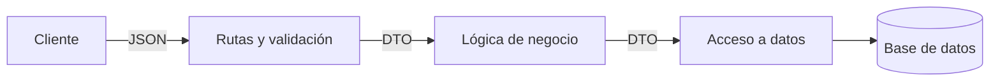

# DTO y validación de datos en Node.js con Express

## Introducción

Cuando una [API](../conceptos/api.md) recibe datos del cliente, esos datos no siempre llegan completos ni con el formato esperado. Esta lección muestra cómo usar un [DTO](../conceptos/dto.md) para definir la forma de los datos, [validarlos](../conceptos/validacion-de-datos.md) y [sanearlos](../conceptos/sanitizacion-de-datos.md) con [express-validator](../conceptos/express-validator.md), y cómo responder a los errores de forma uniforme con un [manejo centralizado de errores](../conceptos/manejo-centralizado-de-errores.md).

---

## 1. ¿Qué es un DTO?

Un **DTO** (*Data Transfer Object*, objeto de transferencia de datos) es un patrón de diseño que sirve como contenedor simple para transportar datos entre capas o componentes de una aplicación. Un DTO suele contener campos y sus métodos de acceso, pero no tiene lógica de negocio. Su función es llevar los datos de un lugar a otro de forma estructurada, sin procesarlos.

Los DTO son útiles en arquitecturas que separan responsabilidades, como la arquitectura de tres capas: presentación, lógica de negocio y acceso a datos.



Un DTO tiene estas características:

* **Estructura coherente:** define la forma de los datos de manera clara.
* **Seguridad:** permite enviar solo los datos necesarios, por ejemplo sin la contraseña de un usuario.
* **Desacoplamiento:** actúa como objeto intermedio entre capas, así cada capa puede cambiar sin afectar a las demás.
* **Facilidad de mantenimiento:** un cambio en la estructura de los datos se concentra en una sola clase.

### 1.1 Implementación básica

El siguiente ejemplo no usa [Express](../conceptos/express.md). Muestra la idea del DTO y una validación manual, que después se reemplazará por express-validator:

```javascript
// DTO: define la forma de los datos del usuario
function createUserDTO(name, email, age) {
    return { name, email, age };
}

// Validación manual de los datos
function validateUser(name, email, age) {
    if (!name || typeof name !== 'string' || name.trim() === '') {
        throw new Error('El nombre es requerido y debe ser una cadena no vacía.');
    }

    if (!email || typeof email !== 'string' || !email.includes('@')) {
        throw new Error('El email es requerido y debe ser una dirección de correo válida.');
    }

    if (!age || typeof age !== 'number' || age <= 0) {
        throw new Error('La edad es requerida y debe ser un número positivo.');
    }
}

function createUser(name, email, age) {
    validateUser(name, email, age);

    // Aquí podrían hacerse otras operaciones, como guardar el DTO en una base de datos
    return createUserDTO(name, email, age);
}

try {
    const userData = createUser('John Doe', 'john@example.com', 30);

    console.log('Nombre:', userData.name);
    console.log('Email:', userData.email);
    console.log('Edad:', userData.age);
} catch (error) {
    console.error('Error al crear el usuario:', error.message);
}
```

> [!NOTE]
> Este ejemplo usa funciones y objetos simples. En el proyecto `ejercicios_clase`, los DTO se implementan como clases con campos privados, getters y `toJSON()`. Es otra forma del mismo patrón.

---

## 2. Crear el proyecto

Desde la terminal:

```bash
mkdir mi-proyecto
cd mi-proyecto
npm init -y
npm install express express-validator
touch app.js
```

El proyecto usa `import`, así que el `package.json` debe incluir la propiedad `"type": "module"`:

```json
{
  "name": "mi-proyecto",
  "version": "1.0.0",
  "main": "app.js",
  "type": "module",
  "scripts": {
    "start": "node app.js"
  },
  "dependencies": {
    "express": "^5.3.0",
    "express-validator": "^7.2.0"
  }
}
```

---

## 3. Primera versión con express-validator

Archivo `app.js`:

```javascript
import express from 'express';
import { body, validationResult } from 'express-validator';

const app = express();
app.use(express.json());

// DTO: estructura de datos del usuario
function createUserDTO(name, email, age) {
    return { name, email, age };
}

// Ruta para crear un usuario con validaciones
app.post(
    '/user',
    [
        // Validaciones declarativas
        body('name')
            .notEmpty().withMessage('El nombre es requerido.')
            .isString().withMessage('El nombre debe ser una cadena.')
            .trim(),
        body('email')
            .notEmpty().withMessage('El email es requerido.')
            .isEmail().withMessage('Debe ser un correo válido.')
            .normalizeEmail(),
        body('age')
            .notEmpty().withMessage('La edad es requerida.')
            .isInt({ min: 1 }).withMessage('La edad debe ser un número positivo.')
            .toInt()
    ],
    (req, res) => {
        // Resultado de las validaciones
        const errors = validationResult(req);

        if (!errors.isEmpty()) {
            return res.status(400).json({ errors: errors.array() });
        }

        // Si no hay errores, se crea el DTO
        const { name, email, age } = req.body;
        const userDTO = createUserDTO(name, email, age);

        res.status(201).json({
            message: 'Usuario creado correctamente',
            user: userDTO
        });
    }
);

app.listen(3000, () => {
    console.log('Servidor escuchando en puerto 3000');
});
```

### Piezas principales

| Elemento | Función |
| --- | --- |
| `body('name')` | Define una regla para el campo `name` del cuerpo de la petición (`req.body`) |
| `notEmpty()` | Exige que el campo tenga un valor |
| `isString()`, `isEmail()`, `isInt()` | Validan el tipo o el formato |
| `withMessage()` | Define el mensaje que se devuelve si la regla falla |
| `trim()`, `normalizeEmail()`, `toInt()` | Sanean el [dato](../conceptos/dato.md): limpian o convierten el valor |
| `validationResult(req)` | Reúne los errores de todas las reglas de la petición |

Las reglas se ejecutan antes del controlador. Si hay errores, la respuesta es `400` y el controlador no se ejecuta. Si no los hay, el controlador crea el DTO y responde.

### Pruebas

Con el servidor en ejecución:

```bash
# 201: datos válidos. El email se normaliza y la edad se convierte a número
curl -X POST http://localhost:3000/user \
  -H "Content-Type: application/json" \
  -d '{"name":"Ana","email":"ANA@example.com","age":"30"}'
```

Respuesta esperada:

```json
{
  "message": "Usuario creado correctamente",
  "user": { "name": "Ana", "email": "ana@example.com", "age": 30 }
}
```

```bash
# 400: datos inválidos
curl -X POST http://localhost:3000/user \
  -H "Content-Type: application/json" \
  -d '{"name":"","email":"correo","age":0}'
```

Respuesta esperada: un arreglo `errors` con un elemento por cada regla que falló. Cada elemento incluye `msg`, `path`, `value` y `location`. En este caso habrá tres errores: el nombre, el email y la edad.

---

## 4. Encadenamiento de reglas y middleware de validación

Cada `body()` valida un campo, y sus métodos se encadenan para aplicar varias reglas al mismo campo:

```javascript
body('username')
    .isLength({ min: 5 })
    .withMessage('El nombre de usuario debe tener al menos 5 caracteres');

body('email')
    .isEmail()
    .withMessage('Ingrese un correo electrónico válido');
```

En la segunda versión, la comprobación de errores se mueve a un [middleware](../conceptos/middleware.md) reutilizable, y la ruta se define una sola vez con `app.route()`:

```javascript
import express from 'express';
import { body, validationResult } from 'express-validator';

const app = express();
app.use(express.json());

// DTO para el usuario
function createUserDTO(name, email, age) {
    return { name, email, age };
}

// Middleware que revisa los resultados de las validaciones
function handleValidationErrors(req, res, next) {
    const errors = validationResult(req);

    if (!errors.isEmpty()) {
        return res.status(400).json({ errors: errors.array() });
    }

    next();
}

app
    .route('/user')
    // POST: crear usuario
    .post(
        [
            body('name')
                .notEmpty().withMessage('El nombre es requerido.')
                .isString().withMessage('El nombre debe ser una cadena.')
                .trim(),
            body('email')
                .notEmpty().withMessage('El email es requerido.')
                .isEmail().withMessage('Debe ser un correo válido.')
                .normalizeEmail(),
            body('age')
                .notEmpty().withMessage('La edad es requerida.')
                .isInt({ min: 1 }).withMessage('La edad debe ser un número positivo.')
                .toInt(),
            handleValidationErrors
        ],
        (req, res) => {
            const { name, email, age } = req.body;
            const userDTO = createUserDTO(name, email, age);

            res.status(201).json({
                message: 'Usuario creado correctamente',
                user: userDTO
            });
        }
    )
    // GET: listar usuarios de ejemplo
    .get((req, res) => {
        res.json([
            { name: 'John Doe', email: 'john@example.com', age: 30 },
            { name: 'Jane Doe', email: 'jane@example.com', age: 25 }
        ]);
    });

app.listen(3000, () => {
    console.log('Servidor escuchando en puerto 3000');
});
```

Los cambios de esta versión son:

* `app.route('/user')` define la ruta una sola vez. Cada método (`get`, `post`, `put`, etc.) se encadena sobre la misma URL.
* `handleValidationErrors` puede reutilizarse en cualquier ruta que use validaciones.
* El array de `post` contiene las validaciones y, al final, el middleware que revisa los errores. El último argumento es el controlador.

---

## 5. Manejo centralizado de errores

En la tercera versión, `handleValidationErrors` no responde directamente. Crea un error con su [código de estado](../conceptos/codigo-de-estado-http.md) y lo pasa con `next(err)` a un manejador global. Así, todas las respuestas de error tienen el mismo formato:

```javascript
import express from 'express';
import { body, validationResult } from 'express-validator';

const app = express();
app.use(express.json());

// DTO: estructura de usuario
function createUserDTO(name, email, age) {
    return { name, email, age };
}

// Middleware que convierte los errores de validación en un error de la aplicación
function handleValidationErrors(req, res, next) {
    const errors = validationResult(req);

    if (!errors.isEmpty()) {
        const err = new Error('Errores de validación');
        err.statusCode = 400;
        err.details = errors.array();
        return next(err);
    }

    next();
}

// Manejador global de errores: debe tener cuatro parámetros
function errorHandler(err, req, res, next) {
    console.error('Error capturado:', err.message);

    res.status(err.statusCode || 500).json({
        message: err.message || 'Error interno del servidor',
        errors: err.details || null
    });
}

app
    .route('/user')
    // POST: crear usuario
    .post(
        [
            body('name')
                .notEmpty().withMessage('El nombre es requerido.')
                .isString().withMessage('El nombre debe ser una cadena.')
                .trim(),
            body('email')
                .notEmpty().withMessage('El email es requerido.')
                .isEmail().withMessage('Debe ser un correo válido.')
                .normalizeEmail(),
            body('age')
                .notEmpty().withMessage('La edad es requerida.')
                .isInt({ min: 1 }).withMessage('La edad debe ser un número positivo.')
                .toInt(),
            handleValidationErrors
        ],
        (req, res, next) => {
            try {
                const { name, email, age } = req.body;

                // Regla de negocio: un email bloqueado no puede registrarse
                if (email === 'bloqueado@example.com') {
                    const err = new Error('Este email está bloqueado.');
                    err.statusCode = 403;
                    throw err;
                }

                const userDTO = createUserDTO(name, email, age);

                res.status(201).json({
                    message: 'Usuario creado correctamente',
                    user: userDTO
                });
            } catch (error) {
                next(error);
            }
        }
    )
    // GET: listar usuarios
    .get((req, res, next) => {
        try {
            res.json([
                { name: 'John Doe', email: 'john@example.com', age: 30 },
                { name: 'Jane Doe', email: 'jane@example.com', age: 25 }
            ]);
        } catch (error) {
            next(error);
        }
    });

// Manejador global: se registra después de todas las rutas
app.use(errorHandler);

app.listen(3000, () => {
    console.log('Servidor escuchando en puerto 3000');
});
```

El flujo de los errores es el siguiente:

1. `handleValidationErrors` detecta errores y llama a `next(err)` con `statusCode` y `details`.
2. El controlador lanza un error de negocio, por ejemplo con `statusCode = 403`, y lo pasa con `next(error)`.
3. `errorHandler` responde con el código del error o `500` si no tiene uno.

Pruebas de cada caso:

```bash
# 201: datos válidos
curl -X POST http://localhost:3000/user \
  -H "Content-Type: application/json" \
  -d '{"name":"Ana","email":"ana@example.com","age":30}'

# 400: datos inválidos
curl -X POST http://localhost:3000/user \
  -H "Content-Type: application/json" \
  -d '{"name":"","email":"correo","age":0}'

# 403: email bloqueado por la regla de negocio
curl -X POST http://localhost:3000/user \
  -H "Content-Type: application/json" \
  -d '{"name":"Luis","email":"bloqueado@example.com","age":20}'

# 200: listado de ejemplo
curl http://localhost:3000/user
```

Respuesta del caso `403`:

```json
{ "message": "Este email está bloqueado.", "errors": null }
```

---

## 6. Evolución de las tres versiones

| Versión | Dónde se responde al error | Qué se gana |
| --- | --- | --- |
| 1 | Dentro del controlador | Las reglas y la respuesta están en la misma ruta |
| 2 | En `handleValidationErrors` | El middleware se reutiliza y la ruta queda más limpia |
| 3 | En `errorHandler` | Todas las respuestas de error tienen el mismo formato |

---

## 7. Errores comunes

| Síntoma | Causa | Solución |
| --- | --- | --- |
| `require is not defined in ES module scope` | El proyecto declara `"type": "module"` y el código usa `require` | Usa `import` como en esta lección |
| `Cannot find package 'express-validator'` | La dependencia no se instaló | Ejecuta `npm install express-validator` |
| `req.body` es `undefined` | Falta `express.json()` | Registra `app.use(express.json())` antes de las rutas |
| Los datos inválidos llegan al controlador | Falta `handleValidationErrors` en el array de la ruta | Agrégalo después de las validaciones |
| La respuesta de error no tiene `errors` | El error no tiene `details` | Asigna `err.details` antes de llamar a `next(err)` |
| El error se responde como `500` | El error no tiene `statusCode` | Asigna `err.statusCode` al crear el error |
| El manejador de errores no se ejecuta | Se registró antes de las rutas, o no tiene cuatro parámetros | Regístralo después de las rutas y con `(err, req, res, next)` |

---

## Notas de apoyo

> [!TIP]
> El orden de los métodos de una cadena importa. `trim()` y `normalizeEmail()` modifican el valor, así que deben ir después de las validaciones que revisan ese mismo valor.

> [!NOTE]
> express-validator limpia y valida los datos de entrada, pero no protege la salida. Si un valor se muestra en HTML, debes escaparlo en la capa de presentación para evitar ataques de tipo XSS.

> [!WARNING]
> Nunca devuelvas en la respuesta campos sensibles, como la contraseña de un usuario. El DTO de salida debe excluirlos, aunque el cliente los haya enviado.

> [!NOTE]
> Los códigos de estado de esta lección son los de la lección [API, estados HTTP, parámetros, middlewares y routers](02-api-http-middlewares-routers.md). `400` indica datos inválidos, `403` indica que el usuario no tiene permiso o que la regla de negocio lo impide.

> [!TIP]
> Un manejador de errores centralizado evita repetir `res.status(...).json(...)` en cada ruta. Solo hay que llamar a `next(error)`.

---

## Conexiones

* [API, estados HTTP, parámetros, middlewares y routers en Express.js](02-api-http-middlewares-routers.md): códigos de estado, middlewares y [routers](../conceptos/router.md).
* [Persistencia de datos con MySQL y Node.js](../nodejs/08-persistencia-con-mysql.md) y [Conexión de Node.js y Express con MySQL](03-conexion-nodejs-express-mysql.md): el DTO de entrada se usaría para insertar datos en la [tabla](../conceptos/tabla.md) `productos` o `usuarios`.
* [Principios de diseño — SOLID](../nodejs/05-principios-solid.md): separar la validación, la lógica de negocio y la respuesta en componentes distintos.
* [Patrón de diseño](../conceptos/patron-de-diseno.md): el DTO es uno de los patrones que facilitan la separación de capas.
* [JSON](../conceptos/json.md): formato de los datos que llegan en la petición y que la API devuelve.

---

## Resumen

* Un DTO define la forma de los datos que se transportan entre capas, sin lógica de negocio.
* express-validator declara reglas de validación y sanitización sobre `req.body` y otras partes de la petición.
* `validationResult(req)` reúne los errores. Si hay errores, la respuesta es `400` y el controlador no se ejecuta.
* Un middleware reutilizable como `handleValidationErrors` mantiene las rutas limpias.
* Un manejador de errores centralizado con cuatro parámetros da un formato uniforme a todas las respuestas de error.

<!-- auto:pie -->
---

**Navegación:** [← Anterior: Conexión de Node.js y Express con MySQL](03-conexion-nodejs-express-mysql.md) · [Índice de Express](indice.md)

**Conceptos de esta lección:** [DTO (Data Transfer Object)](../conceptos/dto.md), [Middleware](../conceptos/middleware.md), [express-validator](../conceptos/express-validator.md), [Express.js](../conceptos/express.md), [API (Interfaz de programación de aplicaciones)](../conceptos/api.md), [Node.js](../conceptos/nodejs.md), [Código de estado HTTP](../conceptos/codigo-de-estado-http.md), [Router](../conceptos/router.md), [Manejo centralizado de errores](../conceptos/manejo-centralizado-de-errores.md), [Patrón de diseño](../conceptos/patron-de-diseno.md), [HTTP](../conceptos/http.md), [MySQL](../conceptos/mysql.md), [Validación de datos](../conceptos/validacion-de-datos.md), [Dato](../conceptos/dato.md), [Persistencia de datos](../conceptos/persistencia.md)
<!-- /auto:pie -->
